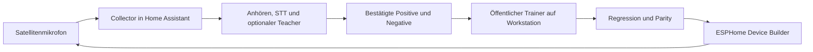

# Home Assistant Wake Word Collector

Eine öffentliche Home-Assistant-Integration für eigene Aktivierungswort-
Aufnahmen mit ESPHome-Satelliten: sammeln, anhören, prüfen, trainieren und ein
freigegebenes Modell ausrollen. Die Mikrofonaufnahmen entsprechen dem
Wakeword-Kanal der Geräte.

[Handbuch](docs/README.md) · [Einrichtung](docs/installation.md) ·
[Aufnahmekarte](docs/review-card.md) · [Unabhängige Prüfung](docs/independent-review.md) ·
[Rollout](docs/rollout.md)

## Einrichtung

HACS → Benutzerdefinierte Repositories →
`https://github.com/ChristophBellmann/ha-wake-word-collector`, Kategorie
Integration. Installieren, HA-Konfiguration prüfen und neu starten.
Unter Einstellungen → Geräte & Dienste Wake Word Collector hinzufügen.
Die Optionen liefern Upload-URL, privaten Token und Befehlssensor.
Das [ESPHome-Paket](docs/satellites.md) mit eigenen IDs, Mikrofonkanal und Gain
in jedes Gerät einbinden.

`type: custom:wake-word-collector-card` zeigt Aufnahmen, Kategorien,
Wellenformeditor und Prüfhinweise an. Sprachbefehle oder GUI-Aufnahme starten
die Sammlung. Reine Wiederholungen werden in vollständige Aufrufe geteilt,
Originale vor Schnitten gesichert. Unklare Clips bleiben zur Prüfung erhalten.

## Training und Fehlalarme

Der öffentliche [Wake Word Trainer](https://github.com/ChristophBellmann/wake-word-trainer)
bietet auf der Workstation Profile, Status und Modelle an. Adresse und
Trainer-Token in den Collector-Optionen eintragen. Der vorhandene Collector-
Token erlaubt ihm bestätigte Daten und getrennt davon ungeprüfte Prüfclips
abzurufen; SSH und sudo werden für diesen Ablauf nicht benötigt.

Die [Prüfung](docs/independent-review.md) zeigt unabhängige STT und optionale
Student-/Teacher-Antworten an der Aufnahme. Vorschläge sind keine automatisch
bestätigten Labels. Erst bestätigte [Fehlalarme](docs/false-alarms.md) werden
negative Trainingsdaten. Ein niedriger Teacher-Score oder leere STT allein
beweisen keinen Fehlalarm.

[Training](docs/training.md), [Ressourcen beim Trainer](https://github.com/ChristophBellmann/wake-word-trainer/blob/main/docs/resources.md)
und [Rollout](docs/rollout.md) halten GPU-Arbeit, Qualität und Firmwareprüfung
getrennt. Prüfprofile und Benchmarks melden kein neues Modell. Der normale
Rollout baut und installiert Geräte über den ESPHome Device Builder und
prüft ihre Rückkehr mit dem erwarteten Firmwarestand.

[Dienste und Entitäten](docs/reference.md), [Lautsprechertests](docs/loudspeaker-test.md),
[Datenschutz](docs/privacy.md) und [Entwicklung](docs/development.md) erläutern
Betrieb und Tests. Persönliche Aktivierungswörter, Modelle, Sprachdaten und
Installationshistorien bleiben privat; das Handbuch verwendet neutrale Beispiele.
