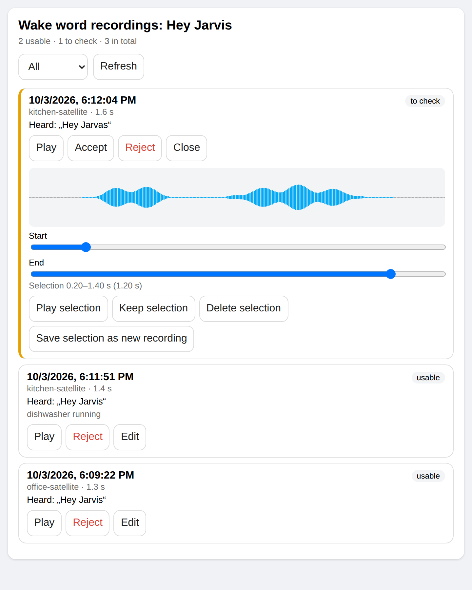
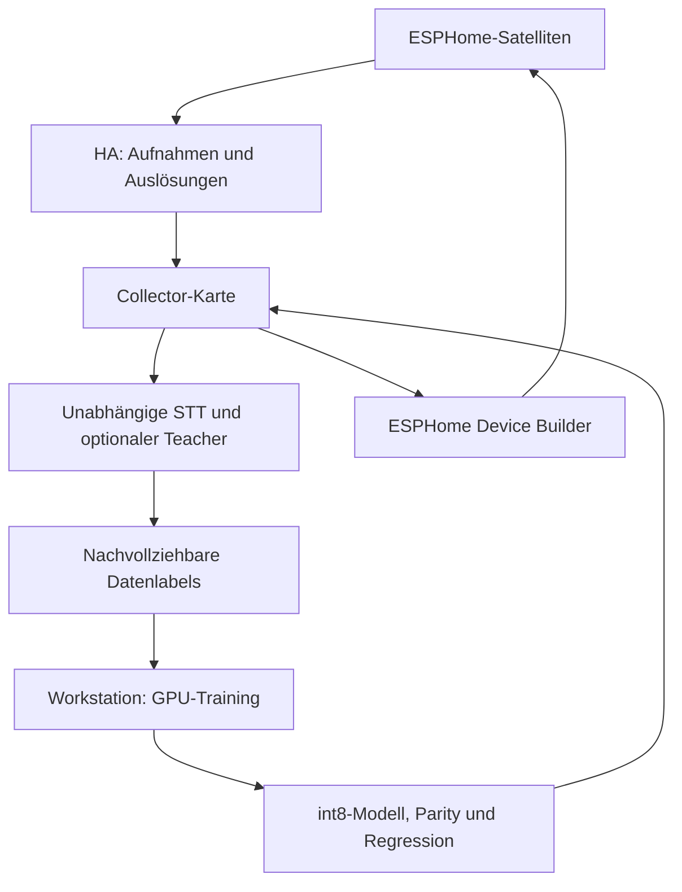

# Wake Word Collector

Eigene Aktivierungswort-Aufnahmen mit den Mikrofonen der ESPHome-Satelliten
sammeln, in Home Assistant anhören und bestätigen, auf der Workstation trainieren
und ein geprüftes Modell auf die Geräte ausrollen.

## Ablauf

1. [Integration installieren](installation.md) und [Satellitenpaket](satellites.md) einbinden.
2. Per [Sprache](voice-commands.md) oder [Karte](review-card.md) aufnehmen.
3. [Auslösungen prüfen](independent-review.md), echte Aufrufe freigeben und bestätigte [Fehlalarme](false-alarms.md) als Negative verwenden.
4. [Training starten](training.md) und das Ergebnis am getrennten Prüfbestand vergleichen.
5. Nur nach Freigabe [ausrollen](rollout.md); [Lautsprechertests](loudspeaker-test.md) prüfen die reale Strecke.

Der Sammelmodus hält Assist offen. Reine Aktivierungswort-Wiederholungen werden
als einzelne vollständige Phrasen gespeichert, ohne Wörter zu trennen.
Ungewöhnliche Transkripte bleiben zur Prüfung erhalten. Befehls- und
Qualitätsaufnahmen werden separat geführt. Der Wellenformeditor sichert
Originale vor jedem Schnitt.

| Kategorie | Zweck |
| --- | --- |
| `candidates` | verwendbare positive Aufnahmen |
| `needs_review`, `rejected_transcript` | ungeprüfte Aufnahmen |
| `triggers` | Ton unmittelbar vor einer gemeldeten Auslösung |
| `negatives` | bestätigte Sprache/Geräusche ohne Aktivierungswort |
| `control` | erkannte Steuerbefehle |
| `rejected_quality` | Qualitätsprobleme oder Ablehnung; zur Wiederherstellung behalten |

Stimmdaten, Texte und persönliche Installationshistorien bleiben privat.
Die öffentliche Anleitung verwendet neutrale Beispiele und erklärt Funktionen
auf Deutsch. [Datenschutz](privacy.md) und [Referenz](reference.md) erläutern
Speicherung, Dienste und Entitäten.
