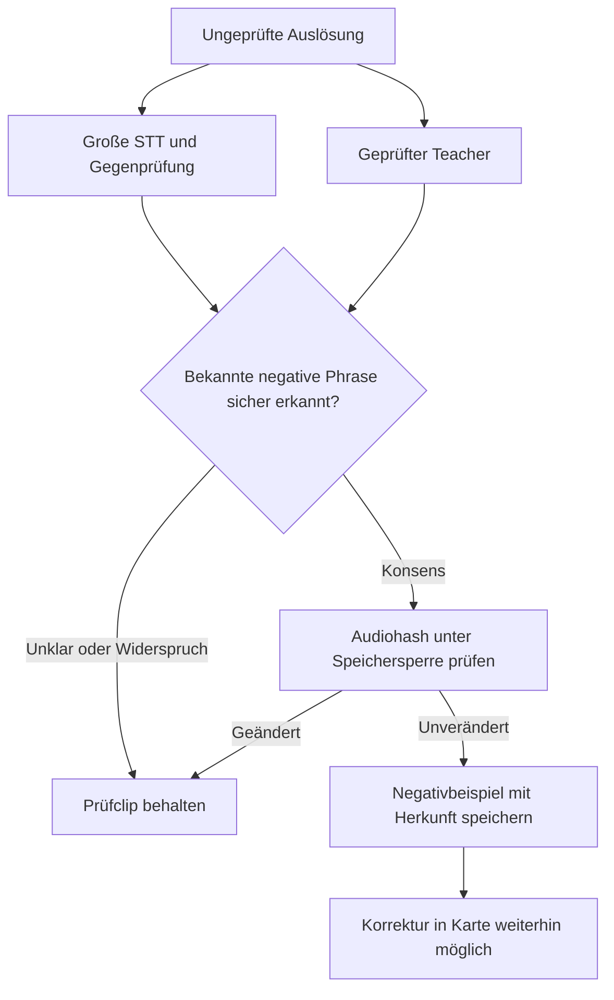

# Auslösungen mit STT und Teacher prüfen

Ab Collector 0.5.5 und Trainer 0.6.1 lässt sich die Prüfung direkt aus Home
Assistant starten. Die Workstation ruft ungeprüfte Clips über den vorhandenen
Collector-Token ab, erkennt Sprache unabhängig und bewertet optional das
Student-Modell und einen geprüften Teacher. SSH und sudo gehören nicht zu
diesem Ablauf.

## Einrichtung und Bedienung

Collector über HACS aktualisieren, Home-Assistant-Konfiguration prüfen,
anschließend neu starten und die Frontend-Seite neu laden. Den Trainer auf
der Workstation aktualisieren und das `segment`-Extra installieren. In dessen
privatem `service.yaml` unter den vorhandenen Profilen hinzufügen:

```yaml
profiles:
  # Vorhandene Trainingsprofile behalten.
  review:
    label: Fehldetektionen prüfen
    kind: review
    days: 7
    limit: 500
    stt_model: medium
    threads: 4
    # device: bath
    # teachers: [teacher/model.pt]
```

Den Trainer-Dienst neu starten, wenn kein Lauf aktiv ist. Die vorhandene
Trainer-Adresse und dessen Token in den Collector-Optionen sowie der
Collector-Token in dessen Trainer-Projekt bleiben gültig. Für den optionalen
Teacher werden das Trainer-Extra `teacher` und ein geprüftes portables Modell
benötigt. Das eingesetzte Student-Modell wird aus
`deployment.reference_model` gelesen, wenn vorhanden.

Die Collector-Karte zeigt **Aufnahmen prüfen**, sobald der Trainer ein
Prüfprofil anbietet. Der Knopf startet `review`, andernfalls das erste
Prüfprofil. Andere Raum-/Zeitraumprofile können über die bestehende Auswahl
und den Trainingsstartknopf gestartet werden. Nach dem Abschluss aktualisiert
sich die Karte und zeigt neben der Aufnahme den unabhängigen STT-Text,
Student-/Teacher-Antworten und den Prüfvorschlag.

**Negativkandidat** bedeutet: anhören und entscheiden. Mit **Fehlalarm** wird
ein bestätigter Gesprächsclip zum Negativbeispiel; mit **War das Aktivierungswort**
wird ein echter Aufruf freigegeben. Unklare Clips bleiben stehen. Leere STT und
ein niedriger Teacher-Score beweisen keinen Fehlalarm; auch echte Aufrufe
werden gelegentlich falsch transkribiert. Unterschiedliche Modellantworten
sind nicht automatisch als Wahrscheinlichkeiten vergleichbar.

Die Prüfung ändert keine Labels, meldet kein neues Modell und startet keinen
Rollout. Erst nach Bestätigung läuft das normale GPU-Training. Für einen
Raumvergleich zusätzlich echte positive Aufrufe desselben Satelliten sammeln.

## Bestand und Datenschutz

`days` bezieht sich auf die Speicherzeit in HA, nicht auf einen exakt
synchronisierten Auslösezeitpunkt. Die neuesten Clips kommen zuerst; `limit`
begrenzt den Bestand. Ein gekürzter Bericht (`truncated`) erfasst nicht alle
passenden Aufnahmen. Gerät oder Zeitraum dann enger wählen.

Ungeprüfte Auslösungen bleiben getrennt vom positiven und negativen
Trainings-Export. Die neuen read-only GET-Routen benötigen den vorhandenen
`X-Wakeword-Token`:

| Route | Inhalt |
| --- | --- |
| `/api/wake_word_collector/export/<slug>/review` | Liste aus `triggers`, `needs_review`, `rejected_transcript`; Filter `device`, `created_after` mit Zeitzone, `limit` von 1 bis 2.000 |
| `/api/wake_word_collector/export/<slug>/review/<category>/<device>/<filename>` | WAV eines solchen Prüfclips |

Liste und Audio werden mit `Cache-Control: private, no-store` ausgeliefert.
Die Workstation legt je Lauf einen privaten Snapshot und Bericht außerhalb von
Git an. Der Detailbericht kommt über den tokenisierten Trainer-Endpunkt
`/v1/review` und den angemeldeten Collector-WebSocket zur Karte. Neue
Analyse-Transkripte werden nicht als Sensorattribute an den Recorder gegeben.
Der Audiohash verhindert die Anzeige einer alten Bewertung nach dem Schnitt.

STT und optionale Bewertungsmodelle laufen bei dieser Prüfung auf der CPU;
die Workstation pausiert dafür keine GPU-Dienste. Training und Benchmarks
nutzen weiterhin ihre GPU-Profile. Speicher-/CPU-Prüfung und die Sperre gegen
einen zweiten Lauf desselben Trainer-Dienstes bleiben wirksam.

Die vollständige [Trainer-Anleitung zur HA-Prüfung](https://renewable-energy-design.gitbook.io/renewable-energy-design-docs/uebersicht/wake-word-trainer/home-assistant/home-assistant-review)
beschreibt Snapshots, Konfiguration, lokale gezielte Abrufe und Fehlerfälle.

## Begrenzte automatische Negativentscheidungen

Dieser Ablauf benötigt kompatible Collector-/Trainer-Releases mit der
Konsens-Review-Schnittstelle; deren Release-Hinweise bestimmen die
Verfügbarkeit. Ein ausdrücklich konfiguriertes Prüfprofil kann bekannte
negative Geräteansagen übernehmen. Große lokale GPU-STT,
ein zweites STT-Modell und geprüfte Teacher müssen übereinstimmen; leere,
unsichere oder widersprüchliche Ergebnisse bleiben offen. Die private Richtlinie
enthält bekannte Phrasen, Konfidenzgrenzen und freigegebene Teacher-Hashes.
Sie ist standardmäßig nicht aktiviert.

Zusätzlich muss ein HA-Administrator in den Integrationsoptionen
**Automatische Negativentscheidungen erlauben** einschalten. Ohne diese
standardmäßig ausgeschaltete Freigabe verweigert der Collector die schreibende
Reviewroute auch bei gültigem Recorder-Token. Ein Tokenwechsel allein schaltet
sie nicht ein. Erst den Wechsel aller Verbraucher prüfen, dann eine passende
Konsensrichtlinie und diese zusätzliche Schreibberechtigung freigeben.

Der Recorder-Token lässt sich über **Neu konfigurieren** am vorhandenen
Integrationseintrag ersetzen. Der Passwortdialog zeigt keinen bisherigen Wert
und ändert weder Phrase noch Speicherort oder Trainerzugang. Der bestehende
Entry-Update-Listener lädt nur diese Integration neu; ein Fehler dabei setzt
keinen alten Token zurück. Alte Firmware und Clients werden nach dem Wechsel
für Aufnahme-Upload und Export abgewiesen, bis sie den neuen Token verwenden.
HA-Bearer, WLAN, native ESPHome-API und OTA haben davon getrennte Credentials.



Der Trainer sendet den Entscheid per POST an die vorhandene tokenisierte
Audio-Review-Route. Ausschließlich ungeprüfte `triggers` dürfen negativ werden;
Positive können darüber nicht freigegeben werden. Der Audiohash wird atomar
mit der Verschiebung geprüft. Nach Schnitt oder bereits erfolgter Bewertung
wird die Entscheidung mit 409 abgelehnt. `analysis_decisions.jsonl` hält
Teacher-Hashes und Prüfkennung privat fest.

Die Karte zeigt einen übernommenen automatischen Negativentscheid und erlaubt
die Korrektur zu einer positiven Aufnahme. Diese Übernahme allein startet
keinen Rollout. Teacher-Ziele können breiter als das Student-Ziel sein; deren
Scores und Labelrollen müssen getrennt geprüft werden. Die vollständige
[Trainer-Anleitung](https://github.com/ChristophBellmann/wake-word-trainer/blob/main/docs/home-assistant-review.md)
beschreibt GPU-Engine, getrennte Umgebungen und private Richtlinien.
