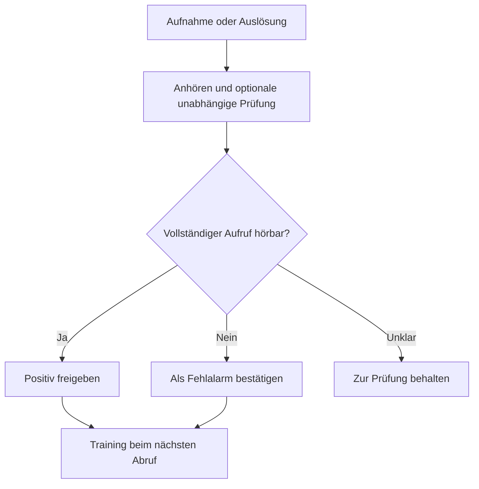

# Aufnahmekarte und Wellenformeditor

Die Karte wird automatisch geladen. Mit
`type: custom:wake-word-collector-card` einem Dashboard hinzufügen. Texte
folgen der HA-Sprache; Deutsch ist vollständig enthalten.

Aufnahmen anhören, bestätigen, ablehnen oder als Fehlalarm markieren.
Abspielen öffnet eine Wellenform mit laufender Positionsmarke. Der aktive Clip
ist hervorgehoben, sein Knopf stoppt die Wiedergabe. Sehr leise Wellenformen
werden sichtbar vergrößert und mit Faktor gekennzeichnet; das Audio bleibt
unverändert. Der Editor kann Bereiche behalten, entfernen oder als neuen Clip
ausschneiden; Originale werden vorher gesichert.

## Aufnahme ohne Sprachbefehl

`wake_word_collector.record` mit Gerätekennung startet oder beendet eine
Mikrofonaufnahme. `stop` beendet und speichert ebenfalls. Lange Aufnahmen
werden anhand `wake_word_manual_duration` segmentiert, standardmäßig 30,
höchstens 120 Sekunden. Zwischen Segmenten entstehen kurze Upload-Pausen.
Die ganze Segmentaufnahme bleibt erhalten, auch vor der ersten Spracherkennung.

## Unabhängige Prüfung und Extraktion

[Aufnahmen prüfen](independent-review.md) startet ein konfiguriertes Trainer-
Prüfprofil. Die Karte zeigt danach unabhängige STT, Student-/Teacher-Antworten
und Vorschläge. Das ist noch kein bestätigtes Trainingslabel.

Für lange manuelle Aufnahmen kann der Trainer mit `segment`-Extra und
`extraction.enabled: true` vollständige konfigurierte Phrasen ausschneiden.
Die Karte bietet automatische Extraktion neuer manueller Aufnahmen und einen
Knopf für bestehende Clips oder Wiederholungen. Originale bleiben unverändert;
Ausschnitte warten auf Freigabe. Fehler und fehlende Treffer bleiben sichtbar,
unterbrochene Arbeit wird beim Laden fortgesetzt. Erfolgreiche Wiederholungen
erzeugen keine identischen Duplikate.

`recordings_entity` kann den Statistik-Sensor auswählen, `device_names` ordnet
Kennungen Anzeigenamen zu. Aufnahmestand und neue Analyseberichte aktualisieren
die Karte ohne manuelles Neuladen. Die Dienste `extract` und `auto_extract`
bieten dieselben Extraktionsaktionen.
