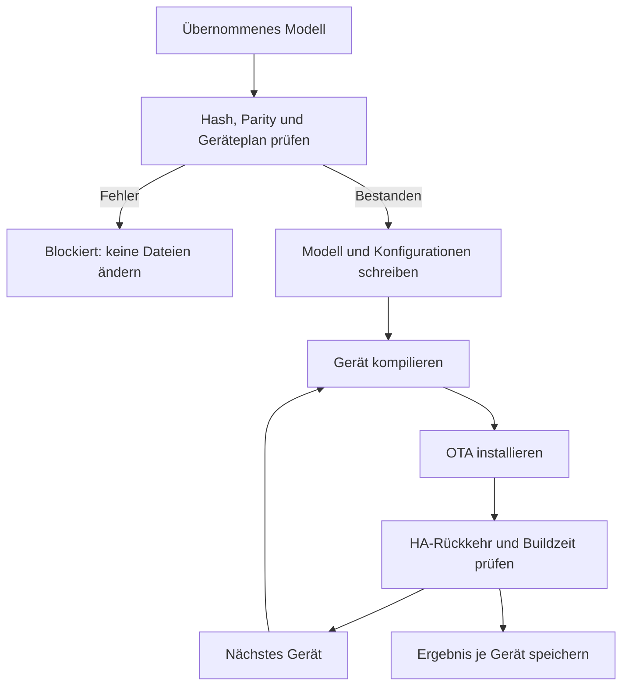

# Modell auf Satelliten ausrollen

Training, Prüfung und Installation bleiben in Home Assistant. Die Integration
schreibt das freigegebene Modell in ESPHome-Konfigurationen und baut und
installiert Geräte nacheinander über den ESPHome Device Builder. Ein Gerät ist
erst geprüft, wenn es mit der erwarteten neuen Kompilierungszeit zurückkehrt.

## Einrichtung

Eine [Rollout-Konfiguration](../esphome/model_update.example.yaml) neben den
ESPHome-Dateien anlegen, beispielsweise `esphome/wake-word-model.yaml`.
Gerätedateien sind relativ dazu und müssen genau den im Builder bekannten
Konfigurationsnamen entsprechen. In den Collector-Optionen diesen Pfad angeben.
Beim Add-on kann die Builder-Adresse leer bleiben; bei eigenem Dienst dessen
Adresse eintragen, zum Beispiel `http://127.0.0.1:6052`.

HA braucht Schreibzugriff und der Builder muss dieselben Dateien sehen.
`button.<slug>_rollout_model` startet, `switch.<slug>_auto_rollout` aktiviert den
Rollout jedes übernommenen geprüften Modells. `require_parity: true` verlangt
einen bestandenen Trainervergleich für den exakten Modellhash.



## Ablauf und Wiederholung

`dry_run: true` liefert nur Plan und Empfindlichkeitsstufen. Danach werden
TFLite und Manifest kopiert und Gerätedateien geändert. Der Builder kompiliert
und installiert über die konfigurierte Adresse oder mDNS. Bereits für genau
dieses Modell, diese Konfiguration und Adresse geprüfte Geräte werden übersprungen.

Die Prüfung wartet bis zu fünf Minuten auf Rückkehr mit der vom Builder
gemeldeten `build_time_str`. Auch ein wiederverwendeter Build muss passen.
Fehlt eine genaue Builder-Zeit, muss sich die vorherige Kompilierungszeit ändern.
Ohne ESPHome-Eintrag gilt ein Gerät nur als installiert, nicht als geprüft.
Ein Gerätefehler verhindert nicht die weiteren Geräte; Wiederholung bearbeitet
nur noch ungeprüfte Geräte. Ein HA-Neustart unterbricht einen laufenden Rollout.

`sensor.<slug>_rollout`, das Ereignis `wake_word_collector_rollout_finished`
und eine Benachrichtigung enthalten den Stand. Private Details und letzte
Builder-Logzeilen liegen unter `<storage>/model/rollout.json`.
Geänderte ESPHome-Dateien und Modelle bei eigener Git-Verwaltung separat sichern.

## Builder in Docker

Das Add-on braucht keine weitere Einrichtung. Ein eigener Container benötigt
denselben Konfigurationsbestand und alle Secrets sowie einen eigenen `/build`-
Ordner. Build-Dateien unterschiedlicher ESPHome-Installationen nicht teilen.
Identische Pfade in beiden Containern erleichtern relative Dateizuordnung.
ESPHome-Version-Historie deaktivieren, wenn deren Konfigurationsordner bereits
Teil eines anderen Git-Repositories ist.

## Fehler eingrenzen

| Meldung | Prüfen |
| --- | --- |
| Gerät nicht im Builder | relativer Pfad und dessen Konfigurationsliste |
| Kompilierung oder Installation fehlgeschlagen | letzte Logzeilen; Zeitlimits für Build und Installation |
| Builder nicht erreichbar | Optionen, laufender Dienst und Netzwerkzugriff |
| Nicht geprüft | tatsächliche HA-Rückkehr mit erwartetem Firmware-Build |
| Blockiert | Modellhash und bestandene Parity; es wurde nichts geschrieben |

## Kommandozeile

[model_update.py](../esphome/model_update.py) verwendet dieselbe Planung.
`{hash}` im Modellnamen verhindert Kollisionen. Für einen vom Trainer gestarteten
Rollout `--expected-sha256 {sha256} --wait 120 --build` verwenden, damit genau
dieses Modell und dessen Vergleich vorliegen.

```bash
python3 model_update.py --config wake-word-model.yaml --dry-run
python3 model_update.py --config wake-word-model.yaml --build
```

Der Build-Befehl darf nur nach tatsächlicher Firmware-Prüfung Erfolg melden.
Fortschritt liegt in `source/rollout.json`; erfolgreiche Geräte werden bei
Wiederholung ausgelassen. `--commit` committet erst nach Erfolg aller Builds.
Gerätepfade, Zugangsdaten und konkrete Installationshistorie bleiben privat.
