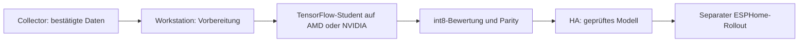

# Training über Home Assistant

Der öffentliche [Wake Word Trainer](https://github.com/ChristophBellmann/wake-word-trainer)
läuft auf der Workstation. Adresse und Token in den Collector-Optionen eintragen.
Die Integration zeigt Erreichbarkeit, Zustand, Fortschritt und Profile; ein
Start-/Stoppknopf verwendet die lokal vorkonfigurierten Einstellungen.



`sensor.<slug>_training` enthält Zustand und Metriken,
`sensor.<slug>_training_progress` den Fortschritt. `select.<slug>_training_profile`
und die Start-/Stoppknöpfe bedienen den Dienst. `sensor.<slug>_model` zeigt das
zuletzt übernommene Modell. Es wird unter der lokalen HA-Modellroute für den
ESPHome-Build bereitgestellt:

```yaml
micro_wake_word:
  models:
    - model: http://homeassistant.local:8123/api/wake_word_collector/model/my_word/my_word.json
```

Die Prüfung neuer Auslösungen kann über die [Karte](independent-review.md)
STT und optional Teacher/Student vergleichen. Prüfprofile und GPU-Benchmarks
melden kein neues Modell und lösen keinen Rollout aus. `phase` erklärt normale
CPU-Arbeit beim Abruf, Feature-Bau oder int8-Vergleich; das Student-Training
läuft anschließend auf dem konfigurierten Gerät.

Bei zu wenig RAM, CPU oder GPU-RAM verweigert der Dienst den Start mit Grund.
GPU-Verbraucher können kontrolliert pausiert und danach wiederhergestellt
werden. [Trainer-Handbuch](https://github.com/ChristophBellmann/wake-word-trainer/blob/main/docs/README.md)
erklärt Ressourcen, Benchmarks und Training in ruhigen Nachtstunden.

Bestätigte Positive werden über `/api/wake_word_collector/export/<slug>` und
Negative über dessen `/negatives`-Route mit dem Collector-Token abgerufen.
Ungeprüfte Clips haben eine getrennte Review-Route. Daten bleiben privat,
Trainings-/Prüfrollen getrennt und ein besserer Durchsatz ist keine
Modellfreigabe. [Rollout](rollout.md) beschreibt die anschließende Geräteprüfung.
